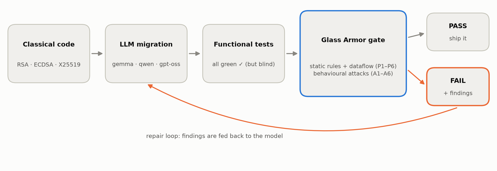
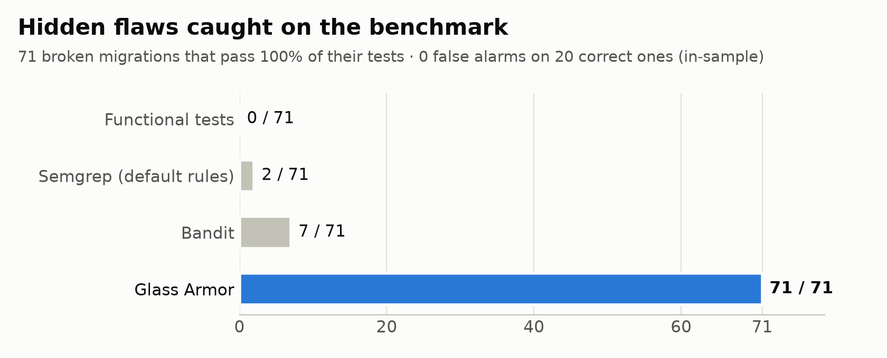
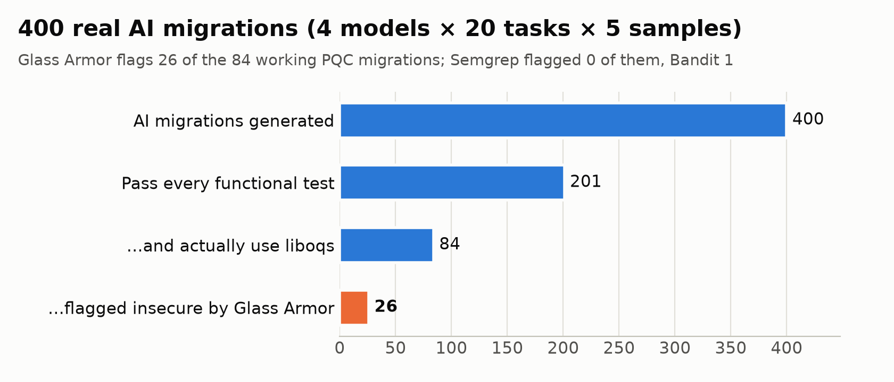
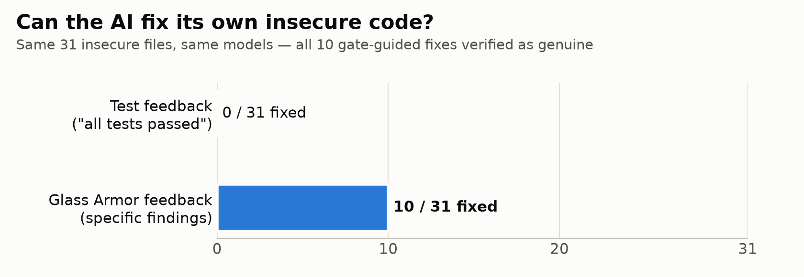

<div align="center">

# 🛡️ Glass Armor

### Passing Tests, Failing Security in LLM-Driven Post-Quantum Migrations

*AI-migrated cryptography can pass every test and still be broken.<br>
Glass Armor is a benchmark, a measurement study and a security gate that shows how often this happens and catches it.*


</div>

---

## The problem in one picture

Quantum computers will break RSA and elliptic-curve cryptography, so code is being migrated to the new NIST standards **ML-KEM** (FIPS 203) and **ML-DSA** (FIPS 204). Much of that migration will be done by AI. Developers then check the result the usual way, by running the existing tests.

**Tests check that the code works. They do not check that it is safe.** The classic example: a migration that uses the raw ML-KEM secret directly as an AES key encrypts and decrypts correctly, so every test passes, yet it skips the key derivation the design requires.

<picture>
  <source media="(prefers-color-scheme: dark)" srcset="docs/images/architecture-dark.png">
  
</picture>

---

## Key results

<table>
<tr><td width="33%" align="center"><h2>0 / 71</h2>hidden flaws caught by<br>the functional tests</td>
<td width="33%" align="center"><h2>26 / 84</h2>working AI migrations<br>flagged insecure by the gate</td>
<td width="33%" align="center"><h2>0 → 10</h2>flaws fixed with test feedback<br>vs gate feedback</td></tr>
</table>

### 1. Tests and standard tools miss the flaws

We planted one realistic flaw in each of 71 correct migrations. Every one of them still passes 100% of its tests.

<picture>
  <source media="(prefers-color-scheme: dark)" srcset="docs/images/benchmark-detection-dark.png">
  
</picture>

> In-sample result (the gate was developed on this benchmark). On **6 held-out variants** written after the gate was frozen it caught **4 of 6**.

### 2. Real AI models make these mistakes

Four models (gemma3:4b, qwen2.5-coder:3b, qwen2.5-coder:7b and gpt-oss-120b) each migrated 20 programs, five times each.

<picture>
  <source media="(prefers-color-scheme: dark)" srcset="docs/images/migration-funnel-dark.png">
  
</picture>

- **117 outputs passed every test while still using the old classical crypto.** The tests cannot even tell whether a migration happened.
- **gpt-oss-120b**, the strongest model, produced 69 working migrations; the gate flags 15 of them (for example, raw KEM secrets used as AES keys, and signatures without context binding).
- A blind, independent review of 35 outputs puts the gate's recall on real migrations at **5 of 8** flaws, with **5 of 6** alarms correct.

### 3. Gate feedback lets the model fix its own code

<picture>
  <source media="(prefers-color-scheme: dark)" srcset="docs/images/repair-dark.png">
  
</picture>

All 10 fixes were checked by hand and are real (for example, adding HKDF key derivation), not tricks to silence the checker. Exact McNemar test: *p* = 0.002.

---

## How the gate works

| Tier | Check | Catches |
|---|---|---|
| **Static** (code is read) | **P1** KEM output must go through a KDF | raw shared secret used as an AES key |
| | **P2** No RSA / ECC left behind | classical fallback still reachable |
| | **P3** No secrets in logs, errors, files | key leaks |
| | **P4** No `random` for key material | weak randomness |
| | **P5** Constant-time MAC comparison | timing leaks |
| | **P6** Hybrid KDF binds both secrets and the ciphertext | unbound hybrid combiners (dataflow analysis) |
| **Adversarial** (code is attacked) | **A1** Break liboqs | silent fallback to classical crypto |
| | **A2** Offer a classical option | downgrade, classical preferred |
| | **A3** Tamper with input and keys | secret leaks, tampering accepted |
| | **A4** Corrupt only the ML-KEM half | hybrid where only classical matters |
| | **A5** Change context or signed fields | signatures that bind the wrong data |
| | **A6** Record every (key, nonce) | AES-GCM nonce reuse |

The verdict is `PASS`, `FAIL` (with findings) or `ERROR` (the gate never reports a crash as a pass). Code under test runs in a throwaway sandbox folder.

---

## Quick start

> Tested on Windows 10, Python 3.11, CPU only. Linux and macOS should work with the usual liboqs install.

```bash
git clone https://github.com/sudarsan2507-hue/GLASS-ARMOR.git
cd GLASS-ARMOR
py -3.11 -m venv .venv
.\.venv\Scripts\pip.exe install -r requirements.txt
```

**Check any Python file with the gate:**

```bash
.\.venv\Scripts\python.exe gate\run_gate.py path\to\your_migration.py --task task_01_file_key_wrap
```

```text
Verdict: FAIL
Flags  : P1
  [P1] line 50: Raw KEM/DH shared secret used directly as an AEAD key (no KDF).
```

<details>
<summary><b>liboqs setup on Windows (prebuilt DLL)</b></summary>

On first import, `liboqs-python` tries to build liboqs from source, which needs CMake and MSVC. This repo instead ships the prebuilt liboqs **0.16.0** DLL, matching `liboqs-python 0.16.0.1`:

| | |
|---|---|
| Package | MSYS2 `mingw-w64-ucrt-x86_64-liboqs-0.16.0-1` |
| Download | https://mirror.msys2.org/mingw/ucrt64/mingw-w64-ucrt-x86_64-liboqs-0.16.0-1-any.pkg.tar.zst |
| File | `ucrt64/bin/liboqs-9.dll`, saved as `vendor/liboqs/bin/oqs.dll` |
| SHA-256 | `14EDAEBF965ED55372B144F35656D6EE3A2C4868E1BB82D4EE07C6D788C015C9` |
| License | MIT (`vendor/liboqs/LICENSE`) |

Point `oqs` at it with a one-line `.pth` file in the venv (for example `.venv/Lib/site-packages/oqs_path.pth`):

```
import os; os.environ.setdefault('OQS_INSTALL_PATH', r'<path-to>\GLASS-ARMOR\vendor\liboqs')
```

Verify:

```
.\.venv\Scripts\python.exe scripts\smoke_test_oqs.py      # ML-KEM-768 + ML-DSA-65
.\.venv\Scripts\python.exe scripts\check_api_card.py      # the prompt's API card runs
```
</details>

<details>
<summary><b>Reproduce the experiments</b></summary>

```bash
python scripts/validate_benchmark.py              # 71/71 broken variants pass every test
python scripts/validate_gate.py                   # gate vs tests, Semgrep, Bandit
python harness/migrate.py                         # 400 LLM migrations (resumable; Ollama + Groq)
python scripts/evaluate.py                        # tests + gate + baselines on every output
python scripts/compare_labels.py labeling/labels_ai.csv
python harness/repair.py                          # repair loop: test vs gate feedback
python scripts/summarize_repair.py
python scripts/make_readme_figures.py             # the charts in this README
```

Local models run through [Ollama](https://ollama.com) (`gemma3:4b`, `qwen2.5-coder:3b`, `qwen2.5-coder:7b`). `gpt-oss-120b` runs on [Groq](https://groq.com); put `GROQ_API_KEY=...` in a `.env` file (git-ignored). All settings (prompt, seeds, temperature) are in `config.yaml`.
</details>

---

## Repository map

```
benchmark/        20 tasks: classical original, correct PQC version, tests, 77 test-passing broken variants
gate/             the Glass Armor gate: Semgrep rules, dataflow checker, adversarial attacks, runner
harness/          migrate.py (LLM migrations) and repair.py (repair loop)
scripts/          validation, scoring, labelling, statistics, figures
results/raw/      all 400 model outputs with full logs (prompt, reply, model version, timing)
results/repair/   every repair round
results/tables/   every result table (CSV)
labeling/         blind-labelling guide, items and labels
docs/             full project report (PDF) and these figures
paper_dossier/    every number with its source, verbatim prompts and rules, code examples
PROGRESS.md       dated log of every step, decision and incident
```

---

## Limitations

- The 71/71 benchmark result is **in-sample**; the honest estimates are the held-out **4/6** and **63% recall** on real migrations.
- Known gate gaps, reported rather than hidden:
  - a suite-naming bug (5 false alarms, already corrected in the numbers above)
  - one API the A5 check does not probe
  - no dataflow tracking through callers
  - name-based P3/P5 rules
- Ground-truth labels come from an independent **AI** reviewer, not a human.
- Python only; 20 tasks; three small local models plus one large API model.

Full details: [`docs/PROJECT_REPORT.pdf`](docs/PROJECT_REPORT.pdf) and [`paper_dossier/DOSSIER.md`](paper_dossier/DOSSIER.md).

## AI-use disclosure

The benchmark, gate, harness and analysis code were built with the help of an AI coding assistant (Claude Code). The labels in `labeling/labels_ai.csv` were produced by an independent AI agent, blind to the gate's verdicts. All counted migrations come only from the evaluated models. See `PROGRESS.md` for the full record.

## Citation

```bibtex
@misc{glassarmor2026,
  title  = {Glass Armor: Passing Tests, Failing Security in LLM-Driven Post-Quantum Migrations},
  author = {Sudarsan},
  year   = {2026},
  url    = {https://github.com/sudarsan2507-hue/GLASS-ARMOR}
}
```

## License

Code is released under the [Apache License 2.0](LICENSE). The bundled liboqs DLL is MIT-licensed ([`vendor/liboqs/LICENSE`](vendor/liboqs/LICENSE)).
