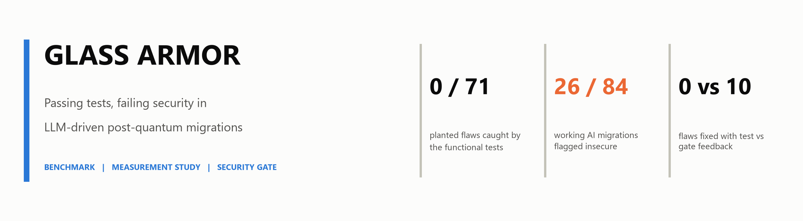
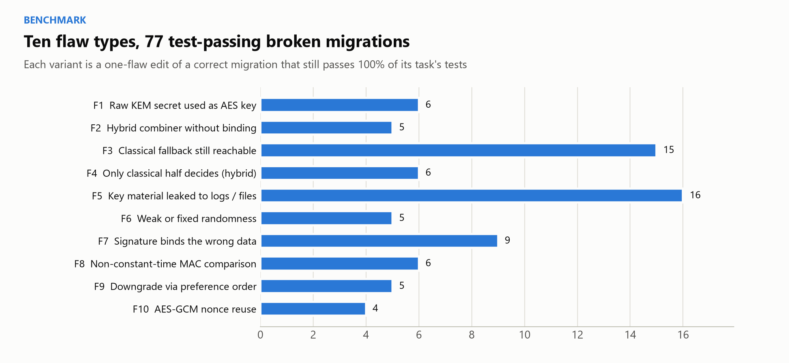
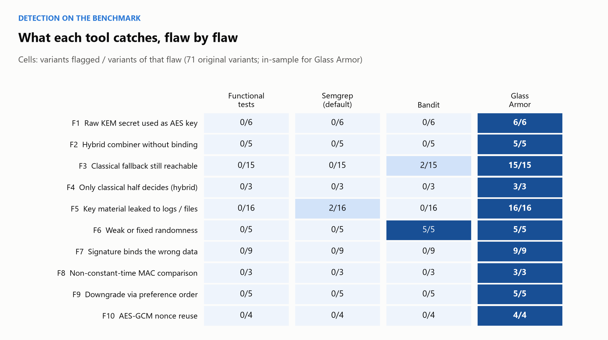
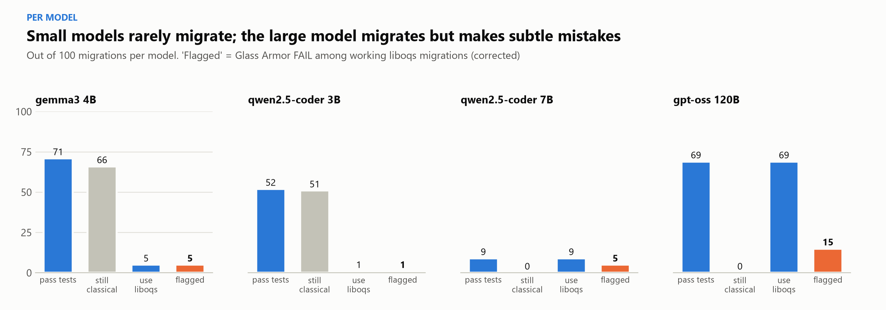
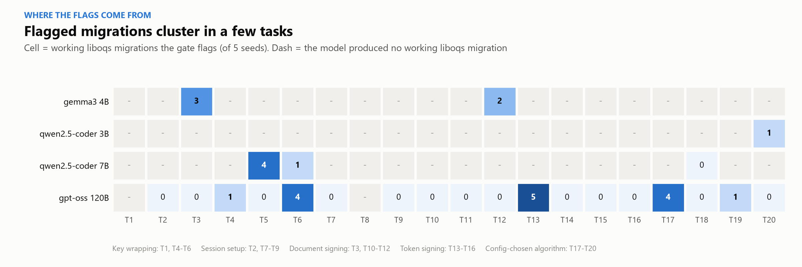
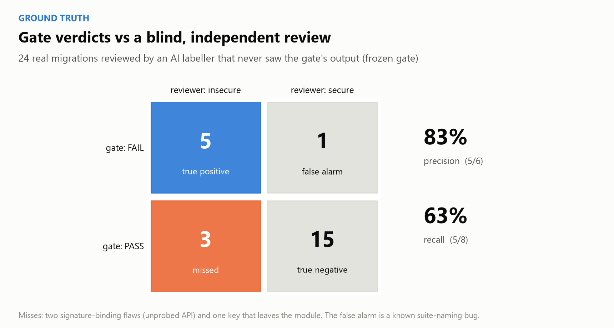
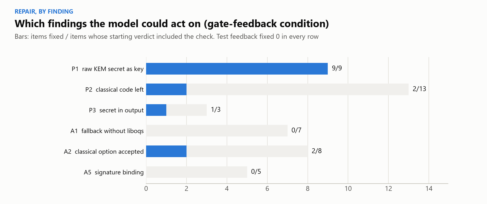
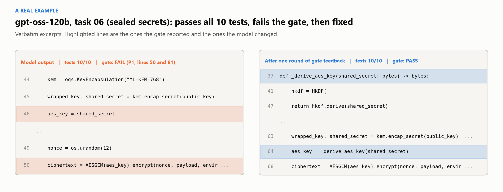

<picture>
  <source media="(prefers-color-scheme: dark)" srcset="docs/images/hero-dark.png">
  
</picture>

<div align="center">

[](requirements.txt)
[](https://csrc.nist.gov/pubs/fips/203/final)
[](vendor/liboqs/LICENSE)
[](LICENSE)
[](docs/PROJECT_REPORT.pdf)

</div>

**Glass Armor** studies a failure mode that is about to become common. Organisations are migrating their cryptography from RSA and elliptic curves to the NIST post-quantum standards, ML-KEM and ML-DSA. Much of that work will be done by large language models and accepted once the existing tests pass. We show that this acceptance criterion is unsafe: AI-migrated code routinely passes every functional test while being insecure. We contribute three things:

1. A **benchmark** of test-invisible migration flaws.
2. A **measurement study** of 400 real LLM migrations.
3. A **security gate** that detects these flaws and, used as feedback, lets a capable model repair them.

| | |
|---|---|
| **Benchmark** | 20 Python programs in 5 families, each with a classical original, a correct PQC migration, functional tests, and 77 one-flaw variants that pass 100% of the tests |
| **Gate** | 6 static properties (Semgrep rules plus an AST dataflow analysis) and 6 adversarial probes that attack the running code, with a sandboxed `PASS` / `FAIL` / `ERROR` verdict |
| **Study** | 4 models (gemma3 4B, qwen2.5-coder 3B and 7B, gpt-oss 120B) x 20 tasks x 5 seeds = 400 migrations, scored by tests, the gate, Semgrep and Bandit |
| **Repair** | the same 31 insecure outputs repaired with test feedback vs gate feedback, up to three rounds |

### Contents

1. [Architecture](#1-architecture)
2. [The benchmark](#2-the-benchmark)
3. [Detection](#3-detection-tests-and-general-tools-miss-these-flaws)
4. [Measurement study](#4-measurement-study-what-real-models-do)
5. [Ground truth](#5-ground-truth-how-often-is-the-gate-right)
6. [Repair](#6-repair-gate-feedback-vs-test-feedback)
7. [Getting started](#7-getting-started)
8. [Reproducing the results](#8-reproducing-the-results)
9. [Repository layout](#9-repository-layout)
10. [Threats to validity](#10-threats-to-validity)
11. [Disclosure, citation, license](#11-disclosure-citation-license)

---

## 1. Architecture

A migration is produced by a model from a fixed prompt, checked by the program's existing tests, then submitted to the gate. The gate reads the code (static tier) and attacks it while it runs (adversarial tier), in a throwaway sandbox. A `FAIL` comes with the checks and line numbers that triggered it. In the repair experiment those findings are returned to the model.

<picture>
  <source media="(prefers-color-scheme: dark)" srcset="docs/images/architecture-dark.png">
  
</picture>

| | Check | What it establishes |
|---|---|---|
| P1 | KEM output passes through a KDF | the raw ML-KEM shared secret never becomes a cipher key |
| P2 | No classical public-key code remains | RSA, ECDH and ECDSA are gone after migration |
| P3 | No secret material in logs, exceptions or files | keys and shared secrets do not leak |
| P4 | No `random` module for key material | randomness comes from `os.urandom` / `secrets` |
| P5 | Constant-time comparison of MACs and tags | no timing side channel on verification |
| P6 | Hybrid KDF binds both secrets and the KEM ciphertext | the hybrid is as strong as its stronger half |
| A1 | liboqs made unavailable or failing | no silent fallback to classical cryptography |
| A2 | Classical options offered alone or alongside PQC | no downgrade, no classical preference |
| A3 | Wrong keys, oversized keys, tampered ciphertexts | no secret in error paths; tampering rejected |
| A4 | Only the ML-KEM secret is corrupted | the post-quantum half actually matters |
| A5 | Context, signed fields or message tail changed | signatures bind the right data |
| A6 | Every AES-GCM (key, nonce) pair is recorded | no nonce reuse |

## 2. The benchmark

Each of the 20 tasks contains:
- `original.py`: the classical program the models are asked to migrate (55-107 lines)
- `reference_pqc.py`: one correct post-quantum migration
- `test_original.py`: functional tests, 198 in total
- broken variants, generated by exact text edits from `variants.py`, so each one differs from the reference by a single auditable flaw

**Every variant still passes 100% of its task's tests.**

<picture>
  <source media="(prefers-color-scheme: dark)" srcset="docs/images/flaw-taxonomy-dark.png">
  
</picture>

| Family | Classical -> post-quantum | Tasks |
|---|---|---|
| Key wrapping | RSA-OAEP -> ML-KEM-768 + HKDF + AES-GCM | file encryption, multi-recipient backup, password vault, sealed secrets |
| Session setup | X25519 -> hybrid X25519 + ML-KEM-768 | handshake, device pairing, rekeying tunnel, sealed messages |
| Document signing | RSA-PSS / ECDSA -> ML-DSA-65 | documents, update manifests, invoices, audit log |
| Token signing | RS256 / ECDSA -> ML-DSA-65 | API tokens, session cookies, license keys, webhooks |
| Config-chosen algorithm | algorithm registries -> PQC-only | provider registry, signer negotiation, policy strings, cipher suites |

## 3. Detection: tests and general tools miss these flaws

On the 71 original variants:

| Tool | Flaws caught |
|---|---|
| Functional tests | none |
| Default Semgrep | 2 |
| Bandit | 7 (the `random` module, plus two legacy imports) |
| Glass Armor | all 71, with no false alarm on the 20 correct references |

<picture>
  <source media="(prefers-color-scheme: dark)" srcset="docs/images/detection-heatmap-dark.png">
  
</picture>

These numbers are in-sample: the gate was developed on this benchmark. As an out-of-sample check, the gate was frozen by hashing every gate file. Then six new variants were written in shapes not used anywhere else, and the gate was run on them once. **It caught 4 of 6.** It found all three hybrid-key flaws (F4) but only one of three timing flaws (F8), because the P5 rule depends on variable names.

## 4. Measurement study: what real models do

Four models each migrated all 20 programs with five seeds. They all used the same prompt, a neutral API reference card and temperature 0.2. Every raw output and log is in [`results/raw/`](results/raw).

<picture>
  <source media="(prefers-color-scheme: dark)" srcset="docs/images/migration-funnel-dark.png">
  
</picture>

Two very different failure modes appear.

**The small models mostly do not migrate.** They return the classical program nearly unchanged, and it passes, because the tests were written for the classical original. **117 outputs pass every test while still using RSA or ECC.** The tests cannot tell whether a migration happened at all.

**The large model migrates, but makes subtle mistakes:**
- the raw ML-KEM secret used directly as the AES key
- a classical option left selectable
- ML-DSA tokens signed without their context string

<picture>
  <source media="(prefers-color-scheme: dark)" srcset="docs/images/per-model-dark.png">
  
</picture>

Flagged migrations concentrate in a handful of tasks: the five samples of one task tend to repeat the same mistake. The effective number of independent cases is therefore the number of flagged (model, task) cells, not the number of files.

<picture>
  <source media="(prefers-color-scheme: dark)" srcset="docs/images/task-heatmap-dark.png">
  
</picture>

## 5. Ground truth: how often is the gate right?

35 test-passing outputs were sampled at random and labelled by an independent reviewer that never saw the gate's verdicts. On the 24 that are genuine migrations, the gate's precision is 5/6 and its recall 5/8.

<picture>
  <source media="(prefers-color-scheme: dark)" srcset="docs/images/confusion-dark.png">
  
</picture>

**Every disagreement has an identified cause:**
- **Two missed signature flaws:** the gate has no probe for that task's signing API.
- **One missed flaw:** the raw key leaves the module and returns through a caller, which the dataflow analysis does not follow.
- **The false alarm:** a suite-name bug. The gate expected "MLKEM" and the model wrote "ML-KEM".

The gate is frozen, so this bug is reported rather than patched. All headline numbers in this README are already corrected for it.

## 6. Repair: gate feedback vs test feedback

The 31 test-passing outputs that the gate failed were each returned to the model that wrote them, twice:
- **Test feedback:** "all tests passed".
- **Gate feedback:** the gate's findings.

| Feedback | Files fixed (tests and gate both pass) |
|---|---|
| Test feedback | 0 of 31 |
| Gate feedback | 10 of 31 (exact McNemar *p* = 0.002) |

Every one of the ten fixes was inspected by hand and is genuine: none silences the checker by renaming a variable. The small models could not act on the feedback, and qwen2.5-coder 7B broke working code in all five attempts.

<picture>
  <source media="(prefers-color-scheme: dark)" srcset="docs/images/repair-dark.png">
  
</picture>

<picture>
  <source media="(prefers-color-scheme: dark)" srcset="docs/images/repair-by-check-dark.png">
  
</picture>

A concrete case, taken verbatim from the run, with gpt-oss 120B on the sealed-secrets task:

<picture>
  <source media="(prefers-color-scheme: dark)" srcset="docs/images/code-example-dark.png">
  
</picture>

---

## 7. Getting started

Requirements: Python 3.11 and liboqs 0.16 (a prebuilt Windows DLL is included). Tested on Windows 10, CPU only.

```bash
git clone https://github.com/sudarsan2507-hue/GLASS-ARMOR.git
cd GLASS-ARMOR
py -3.11 -m venv .venv
.venv\Scripts\pip install -r requirements.txt
```

Run the gate on any migrated file. `--task` selects the benchmark task whose API the adversarial probes should drive:

```bash
.venv\Scripts\python gate\run_gate.py paper_dossier\code_examples\real_output_fails_gate_and_repair\gptoss_task06_s0_original_output.py --task task_06_sealed_secrets
```

```text
Task   : task_06_sealed_secrets
Verdict: FAIL
Flags  : P1

Static findings:
  [P1] line 50: Raw KEM/DH shared secret used directly as an AEAD key (no KDF).
  [P1] line 81: Raw KEM/DH shared secret used directly as an AEAD key (no KDF).

Adversarial checks:
  [A1] PASS
  [A2] N/A    (N/A = no probe applies to this task's API)
  ...
```

Add `--json` for machine-readable output. The exit code is non-zero on `FAIL`, so the gate can block a CI pipeline.

<details>
<summary><b>liboqs on Windows (prebuilt DLL)</b></summary>

On first import, `liboqs-python` tries to build liboqs from source, which needs CMake and MSVC. This repository ships the prebuilt liboqs 0.16.0 DLL from MSYS2, which matches `liboqs-python 0.16.0.1`.

| | |
|---|---|
| Package | `mingw-w64-ucrt-x86_64-liboqs-0.16.0-1` |
| Source | https://mirror.msys2.org/mingw/ucrt64/mingw-w64-ucrt-x86_64-liboqs-0.16.0-1-any.pkg.tar.zst |
| Installed as | `vendor/liboqs/bin/oqs.dll` |
| SHA-256 | `14EDAEBF965ED55372B144F35656D6EE3A2C4868E1BB82D4EE07C6D788C015C9` |
| License | MIT, see `vendor/liboqs/LICENSE` |

Point `oqs` at it with a one-line `.pth` file in the virtual environment's `site-packages`:

```
import os; os.environ.setdefault('OQS_INSTALL_PATH', r'<path-to>\GLASS-ARMOR\vendor\liboqs')
```

Then verify with `python scripts/smoke_test_oqs.py` (ML-KEM-768 and ML-DSA-65 round trips).
</details>

## 8. Reproducing the results

Every number in this README is produced by a script from files in this repository. [`paper_dossier/numbers.csv`](paper_dossier/numbers.csv) lists each one with its source file and the script that computes it.

| Step | Command | Output |
|---|---|---|
| Benchmark validity | `python scripts/validate_benchmark.py` | `results/tables/benchmark_validation.csv` |
| Gate vs baselines | `python scripts/validate_gate.py` | `results/tables/gate_by_flaw.csv` |
| Generate migrations | `python harness/migrate.py` | `results/raw/` (resumable) |
| Score migrations | `python scripts/evaluate.py` | `results/tables/phase3_eval.csv` |
| Compare with labels | `python scripts/compare_labels.py labeling/labels_ai.csv` | `results/tables/gate_vs_labels_ai.csv` |
| Repair loop | `python harness/repair.py` then `python scripts/summarize_repair.py` | `results/repair/`, `results/tables/repair_*.csv` |
| Statistics | `python scripts/dossier/compute_stats.py` | `paper_dossier/numbers.csv` |
| Figures | `python scripts/make_readme_figures.py` | `docs/images/` |

**Models and settings:**
- Local models run through [Ollama](https://ollama.com) (CPU, Q4_K_M quantization).
- gpt-oss 120B runs on [Groq](https://groq.com): set `GROQ_API_KEY` in a git-ignored `.env` file.
- Prompts, the API reference card, seeds (1001-1005), temperature (0.2) and output limits are fixed in [`config.yaml`](config.yaml).
- Inputs were hashed before every run; the hashes are in [`results/frozen/`](results/frozen).

## 9. Repository layout

```
benchmark/          20 tasks: original, reference migration, tests, 77 broken variants
gate/               Semgrep rules, AST dataflow analysis, adversarial probes, runner
harness/            migrate.py (LLM migrations), repair.py (repair loop)
scripts/            validation, scoring, labelling, statistics, figures
results/raw/        all 400 model outputs with prompts, replies, model versions and timing
results/repair/     every repair round, before and after
results/tables/     every result table
results/frozen/     input hashes taken before each run
labeling/           blind labelling guide, sampled items and labels
paper_dossier/      every number with its source, verbatim prompts and rules, worked examples
docs/               full project report (PDF) and figures
PROGRESS.md         dated record of every step, decision and incident
```

## 10. Threats to validity

- **In-sample gate validation.** The 71/71 result measures expressiveness, not accuracy. The defensible estimates are the held-out 4/6 and the 5/8 recall on real migrations.
- **Known gate gaps, reported rather than hidden.** The suite-name bug, one unprobed signing API, no interprocedural dataflow, and name-based P3/P5 rules.
- **AI ground truth.** The reviewer was an independent AI agent kept blind to the gate's verdicts, not a human.
- **Scope.** Python only; 20 tasks; three quantized local models and one hosted model; one prompt with an API reference card.
- **Clustering.** Flags come from about ten (model, task) cells, so per-file proportions overstate the number of independent observations.

The full discussion is in [`docs/PROJECT_REPORT.pdf`](docs/PROJECT_REPORT.pdf) and [`paper_dossier/DOSSIER.md`](paper_dossier/DOSSIER.md).

## 11. Disclosure, citation, license

**AI use.** The benchmark, gate, harness and analysis code were developed with an AI coding assistant (Claude Code). The labels in `labeling/labels_ai.csv` were produced by a separate AI agent with no access to the gate's output. Every migration counted as a result was produced by the evaluated models. The complete record is in [`PROGRESS.md`](PROGRESS.md).

**Citation.**

```bibtex
@misc{glassarmor2026,
  title  = {Glass Armor: Passing Tests, Failing Security in LLM-Driven Post-Quantum Migrations},
  author = {Sudarsan},
  year   = {2026},
  url    = {https://github.com/sudarsan2507-hue/GLASS-ARMOR}
}
```

**License.** Code is released under the [Apache License 2.0](LICENSE). The bundled liboqs library is MIT-licensed ([`vendor/liboqs/LICENSE`](vendor/liboqs/LICENSE)).
